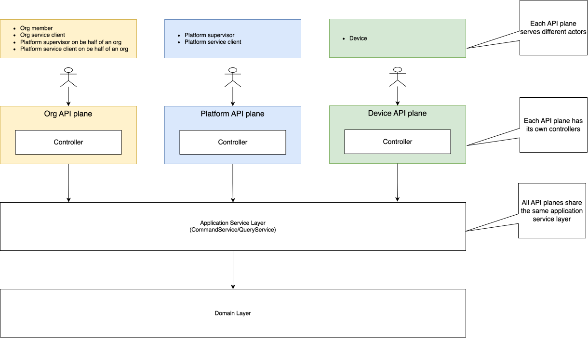

# Split APIs into multiple planes

## Context

In SaaS systems, the APIs are often divided into the following categories:

- APIs consumed by tenant(org) users, such as org members and org service clients, which handles resources under a
  specific tenant.
- APIs consumed by platform users, such as platform administrators and platform service clients, which handles resources
  that are not specific to any tenant but the whole platform.

These API categories deal with different concerns and should be managed separately.

## Decision

All the APIs are split into the following API planes:

- **Org API plane**: contains APIs for manipulating org level resources, can be accessed by the following actors:
    - Org member
    - Org service client
    - Platform supervisor on be half of an org
    - Platform service client on be half of an org
- **Platform API plane**: contains APIs for manipulating platform level resources, can be accessed by the following
  actors:
    - Platform supervisor
    - Platform service client
- **Device API plane**: contains APIs that are consumed by devices, the resources is the device itself, can be accessed
  by the following actors:
    - Device on be half of itself

## Implementation

- If multiple API planes need to expose the same resource endpoint, you need to create separate controllers for each API
  plane, and share the same application service layer implementation.
- For security, each API plane has its
  own [security configurations](../src/main/java/com/company/andy/common/security/SecurityConfiguration.java), a JWT
  token issued for one API plane cannot be used to access another API plane, except for:
    - Platform supervisor and platform service client can access **Org API plane** on behalf of an org, and the `orgId`
      should be provided in the HTTP header `x-org-id`. It is still subjected to access controls.