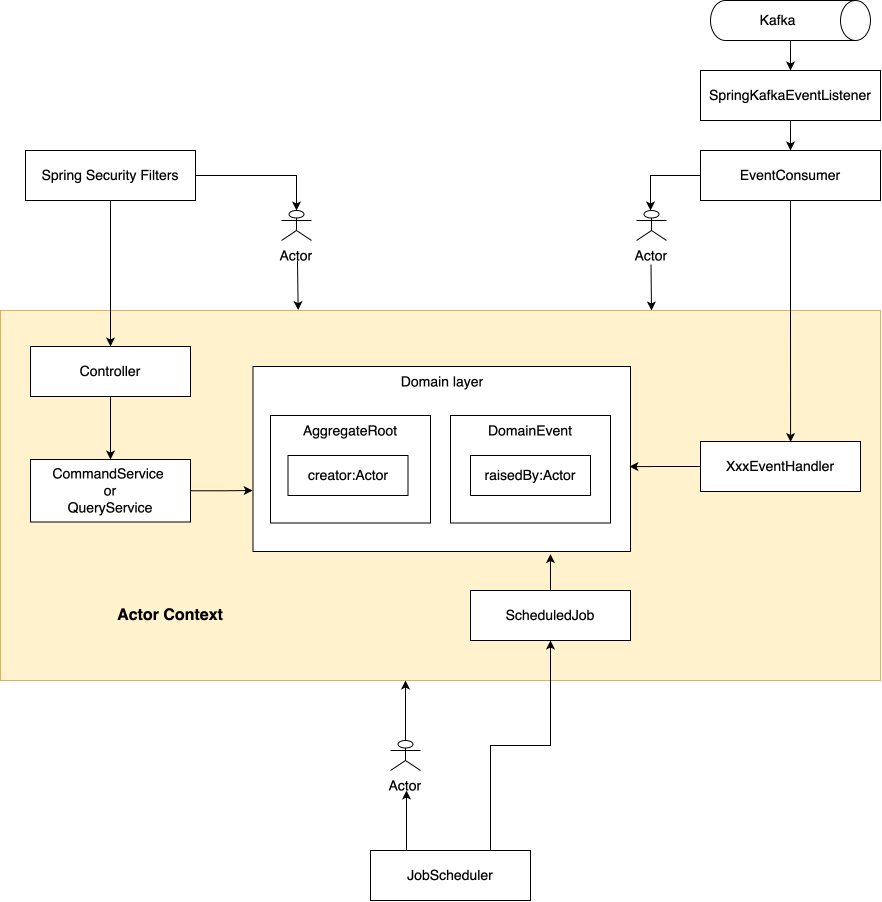

# Implicitly pass through actor context

## Context

When process a request(such as HTTP requests, Kafka messages, etc.), we normally need to tract who is the caller.
This is often called "user context" or "actor context".

There are two common approaches to pass through the actor context:

- Pass the actor context explicitly as a method parameter down to all layers. This approach is explicit but it requires more boilerplate code as it passes the context through multiple layers.
- Store the actor context in a [ThreadLocal](https://www.baeldung.com/java-threadlocal) variable, such as Spring Security's `SecurityContextHolder`.  This has the advantage of being easily accessible from anywhere in the code without needing to pass it explicitly. However, it makes the code implicit and hence increase the cognitive load of the code, also it makes testing harder.

## Decision

We choose to implicitly pass through the actor context, as we prefer less boilerplate code. Also we've created a framework where actor context is rarely needed in the business logic.

## Implementation

We've created a framework where actor context is handled centrally, business code rarely needs to deal with the actor context. The framework uses a [ThreadLocal](https://www.baeldung.com/java-threadlocal) variable to store the actor context, and automatically populates the actor context for each request.



- For HTTP requests, the actor is populated by Spring Security's filters, such as [JwtToOrgActorAuthenticationTokenFilter](../src/main/java/com/company/andy/common/security/JwtToOrgActorAuthenticationTokenFilter.java). In controllers, you can declare your controller method with `@AuthenticationPrincipal` to get the actor object:

```java
    @PostMapping
    @ResponseStatus(CREATED)
    @Operation(summary = "Create an equipment")
    public ResponseId createEquipment(@RequestBody @Valid CreateEquipmentCommand command,
                                      @AuthenticationPrincipal @NotNull Actor actor) {
        return new ResponseId(this.equipmentCommandService.createEquipment(command, actor.requireOrgId()));
    }
```
You should not pass the actor any further than the controllers. Normally in the controller you use the actor to obtain the current `orgId` or `supervisorId` and pass them down the road.


- For event handlers, the actor is centrally populated by [EventConsumer](../src/main/java/com/company/andy/common/event/consume/EventConsumer.java) before the event arrives at the event handler:

```java
    private void handleIdempotently(AbstractEventHandler<?> handler, ConsumingEvent consumingEvent) {
        if (handler.isIdempotent() || this.consumingEventDao.markEventAsConsumedByHandler(consumingEvent, handler)) {
            Object event = consumingEvent.getEvent();
            ActorOrigin origin = ActorOrigin.fromEvent(event.getClass().getName(), consumingEvent.getEventId());
            Actor actor = Actor.createEventHandlerActor(handler.getClass().getName(), origin);
            CurrentActorService.runWithActor(actor, () -> ((AbstractEventHandler<Object>) handler).handle(event));
        } else {
            log.warn("Event[{}:{}] has already been consumed by handler[{}], skip handling.",
                    consumingEvent.getType(), consumingEvent.getEventId(), handler.getName());
        }
    }
```

In event handlers, you do not need to and should not access the actor:
```java
public class EquipmentCreatedEventHandler extends AbstractEventHandler<EquipmentCreatedEvent> {

    @Override
    public void handle(EquipmentCreatedEvent event) {
        log.info("{} called for Equipment[{}].", this.getClass().getSimpleName(), event.getArId());
    }
}
```

- For scheduled jobs, you should create the actor in job scheduler by using `createScheduledJobActor()`, and then use `CurrentActorService.runWithActor()` to run the job with the actor context:

```java
    @Scheduled(cron = "0 */5 * * * ?")
    public void houseKeepPublishStagedDomainEvents() {
        log.debug("Start house keep publish DomainEvents.");
        assertLocked();
        Actor actor = createScheduledJobActor("houseKeepPublishStagedDomainEvents");
        CurrentActorService.runWithActor(actor, () -> domainEventPublisher.publishStagedDomainEvents(100));
    }
```

- The [Actor](../src/main/java/com/company/andy/common/model/actor/Actor.java) object is stored by the framework automatically in the following places:
  - Stored as `actor` field in [AggregateRoor](../src/main/java/com/company/andy/common/model/AggregateRoot.java) whenever the AggregateRoot is created
  - Stored as `raisedBy` field in [DomainEvent](../src/main/java/com/company/andy/common/event/DomainEvent.java) whenever a DomainEvent is created

- If there is really a need to access the current actor, you can use [CurrentActorService.currentActor()](../src/main/java/com/company/andy/common/security/CurrentActorService.java).